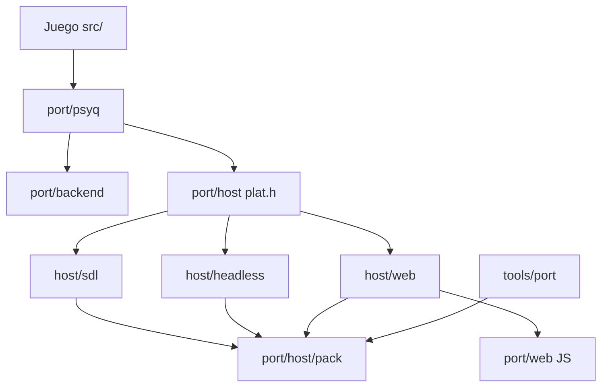
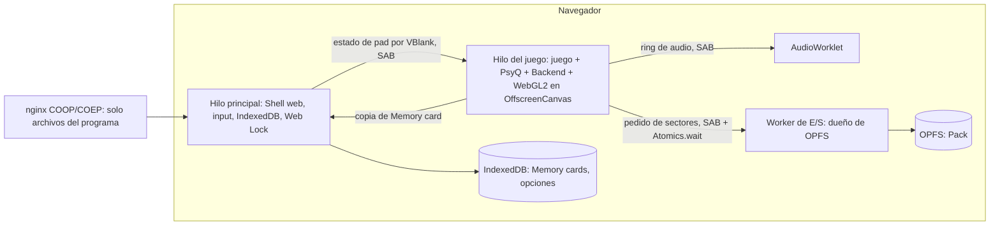
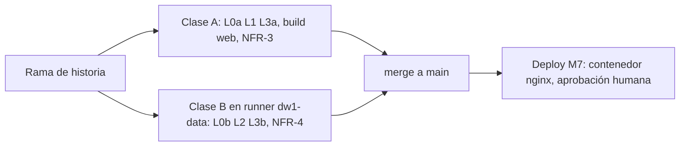

# Architecture Spine — DW1 Web Port

## Design Paradigm

**Capas con plataforma reemplazable.** El juego (C de upstream) no cambia. Debajo, la Capa PsyQ
propia reproduce el contrato de las librerías de Sony sobre un **reloj virtual** único, y el
Backend modela los dispositivos (GPU, GTE, SPU, CD, XA, MDEC). El Host es la única capa que conoce
el sistema operativo o el navegador.

| Capa | Directorio | Contenido |
|---|---|---|
| Juego | `src/`, `include/` (upstream) | C descompilado; cambios solo detrás de `DW1_PORT` |
| Capa PsyQ | `port/psyq/` | Funciones PsyQ que llama el juego, headers PsyQ del port, crt, `clock.c` (tiempo virtual), memoria PS1, overlays |
| Backend | `port/backend/` | Modelos de dispositivo: GPU (software y WebGL2), GTE, SPU, XA, MDEC, CD sobre el Pack |
| Host | `port/host/` | Interfaz `plat_*` y sus implementaciones: `sdl` (nativo con ventana), `headless` (nativo para tests), `web` (Emscripten); `pack/` (Imagen del disco, ISO9660, Pack) |
| Shell web | `port/web/` | HTML/JS: selector de disco, worker de E/S, AudioWorklet, input, IndexedDB/OPFS, service worker |
| Herramientas | `tools/port/` | Manifest, constructor del Pack, diff de frames y audio, Escenas, métricas, checks de CI |



Las flechas son las únicas dependencias permitidas. El Backend no llama a `plat_*`: la Capa PsyQ
le pasa los datos y saca sus resultados (frames, muestras) hacia el Host.

## Invariants & Rules

### AD-1 — Sin `port/recomp/`: el juego entra completo como C [ADOPTED]

- **Binds:** FR-4, FR-5, épica de decomp, reglas 2 y 4 de `CLAUDE.md`
- **Prevents:** dos estrategias para el mismo código, por ejemplo traducción MIPS→C de una función que ya está en C.
- **Rule:**
  - El build del port compila solo `.c` de upstream (el 100 % de las 2741 funciones del juego USA) y no linkea ningún `.s` de `asm/`. No se crea `port/recomp/`.
  - La lista de TUs del juego no se elige a mano ni por directorio. Se genera de `mk/version/us.mk` y `config/us/*.yaml`, igual que la usa el build PS1 USA. Por ejemplo, `vs_intro`, `vs_combat`, `vs_select` y `shop/script_menu` van en `main`, y los `*_bss_{eu,jp*}.c` quedan fuera.
  - Si aparece una función del juego sin C (otra versión, o una regresión de upstream), se descompila con m2c en estilo upstream, se valida por comportamiento y se registra en `docs/port/non-matching.md`.
  - La épica continua de decomp mide tres cosas: funciones del juego en C, funciones PsyQ que usa el juego implementadas en `port/psyq` (x/202) y bloques `DW1_PORT` en `src/`.

### AD-2 — Capa PsyQ propia, partiendo de DW2-PC y del asm de DW1

- **Binds:** FR-4..FR-11, `port/psyq`
- **Prevents:** mezclar la semántica de Psy-Q 4.7 (DW2) con la de `mw_lib41` (DW1), o tener dos implementaciones de una misma función PsyQ.
- **Rule:**
  - Cada función PsyQ que llama el juego tiene una sola implementación, en `port/psyq/<lib>.c`, con un comentario que nombra su fuente: `dw2-pc:<archivo>` (CC0, con atribución) o `asm:asm/us/main/psyq/<lib>.s`. Si DW1 y DW2 difieren, manda el asm de DW1.
  - Los headers PsyQ y de runtime del port (`port/psyq/include/`, incluido `__rts_info_t__.h`) van antes que los de upstream en el include path y conservan los prototipos.
  - Las macros GTE inline se redefinen como llamadas al modelo GTE del Backend, sin tocar `src/`.
  - PsyCross queda descartado mientras su licencia no esté verificada.

### AD-3 — Native es un binario Linux i686 (32 bits)

- **Binds:** FR-17, AD-4, AD-5
- **Prevents:** que structs con punteros, OTs y datos del disco tengan un layout en nativo y otro en web.
- **Rule:**
  - El build native compila con `-m32`: punteros de 4 bytes, como PS1 y wasm32. Corre en Linux x64 con multilib. No hay target de 64 bits.
  - El código del port verifica `sizeof(void *) == 4` con `_Static_assert` en `port/psyq/ps1mem.h`.
  - `native-headless` no usa SDL3.
  - La imagen `dw-port` ya trae `gcc-multilib` (verificado con `tools/port/env_check/overlay_sections/run.sh`). Un SDL3 i686 se agrega en la historia que trae el preset con ventana.

### AD-4 — Memoria: arena PS1 y traducción de direcciones en puntos nombrados

- **Binds:** FR-4, FR-5, `port/psyq/ps1mem.*`, cambios `DW1_PORT` en `src/` e `include/`
- **Prevents:** que un mismo literal `0x80xxxxxx` se traduzca de dos formas, o que el port guarde punteros PS1 crudos.
- **Rule:**
  - **Arena y scratchpad.** La RAM PS1 es la arena `Ps1_Ram[0x200000]`. `PS1_RAM(addr)` = `Ps1_Ram + (addr & 0x1FFFFF)`, y en debug hace `PORT_ASSERT` de que `addr` está en KSEG0/KUSEG de RAM. El scratchpad es `Ps1_Scratchpad[0x400]` (1 KB, como en la consola), con assert de rango en debug, y se accede solo por `getScratchAddr` de los headers del port.
  - **Dónde se traduce.** Un número de dirección PS1 se convierte en puntero nativo solo en dos lugares:
    - Macros y tablas de `src/` e `include/` envueltas en `#ifdef DW1_PORT` con `PS1_RAM()`. Por ejemplo `BTL_*_MODEL`, `*_FINISHER_TIM`, `STD/VS_TMD_BUFFER`, `DOOA_*`, `GENERAL_BUFFER`, `TEXTURE_BUFFER`, `BOSS_EFE_TMD_BUFFER`, `shop_START`, `*_START` y `REL_BIN_OFFSETS`. Cada una se registra en `docs/port/src-changes.md`.
    - Funciones PsyQ que reciben direcciones del juego como enteros, como `InitHeap3`.
  - **Inventario generado.** El inventario de literales `0x80xxxxxx` usados como puntero en `src/` e `include/` lo genera `tools/port/metrics/ps1_literals.py`. L0a falla si aparece uno sin traducir y sin estar listado como no aplicable.
  - **Residuos del juego.** Los valores iniciales de los `*_bss_us.c` (por ejemplo `(GsOT_TAG *)0x80040000`) son residuos del REL: no se traducen ni se tocan.
  - **Heap.** El `__rts_info_t__.h` del port renombra `_end`, `_stack_addr` y `_stack_size` a símbolos del port (`dw1_rts_end`, ...) con los valores PS1, para no chocar con los de GNU ld. Así el heap de `malloc3` queda dentro de la arena, en el mismo rango y con el mismo tamaño que en la consola.
  - **Punteros del port.** El código del port guarda siempre punteros nativos.

### AD-5 — Ventana de 16 MB para enlaces de OT

- **Binds:** `libgpu`/`libgs` del port, layout de memoria de ambos builds, Host
- **Prevents:** que un enlace de OT de 24 bits apunte a memoria que no se puede reconstruir, incluidos primitivos en el stack.
- **Rule:**
  - **Qué entra en la ventana.** Todo lo que puede quedar enlazado en un OT vive en una ventana de 16 MB: globals del juego y del port, arena, buffers de primitivas de PsyQ y **el stack del hilo del juego**.
  - **Web.** La ventana es `[0, 16 MB)` de la memoria lineal. `-sINITIAL_MEMORY` es fijo y no hay crecimiento.
  - **Native.** `-no-pie`; la ventana empieza en el segmento de datos (`__data_start`), así que el código no necesita estar dentro y los globals, la arena y los stacks estáticos sí.
  - **Stack del juego.** El Host crea el hilo del juego con `pthread_attr_setstack` sobre un buffer estático dentro de la ventana, en ambos builds [ASSUMPTION: Emscripten lo respeta; se verifica en el spike de M4; si no, se aborta al arrancar].
  - **Enlaces.** Un enlace es el offset de 24 bits dentro de la ventana. `PS1_LINK(ptr)` es la única forma de construir un enlace (la usan `addPrim`/`setaddr` de los headers del port) y verifica en debug que `ptr` está en la ventana. `PS1_LINK_PTR(link)` es la única forma de volver a un puntero.
  - **Fuera de la ventana.** Los buffers grandes del Backend (VRAM HD, framebuffers) salen de `malloc` y nunca se enlazan en un OT.
  - `native-asan` corre con `detect_stack_use_after_return=0`.

### AD-6 — Overlays: todos linkeados, `.data`/`.bss` restaurados por overlay

- **Binds:** FR-5, los 16 overlays, `port/psyq/overlay.*`, CMake
- **Prevents:** estado viejo de un overlay que sobrevive a su recarga, o dos mecanismos o momentos de reinicio.
- **Rule:**
  - **Pertenencia.** Qué TU pertenece a qué overlay sale de la lista generada de AD-1. Cada TU de un overlay se compila a través de una TU envoltorio generada por CMake: `#pragma clang attribute push(__attribute__((section("dw1ovl_<ovl>"))), apply_to = variable(is_global))`, luego `#define const` (un global `const` volvería la sección de solo lectura), el `#include` del archivo y por último `pop`. Así quedan en la sección los globals, los statics de archivo y los statics locales, incluidos los `const`.
  - **Snapshot.** Al arrancar, antes de entrar al `main` del juego, `port/psyq/overlay.c` guarda una copia de `[__start_dw1ovl_<ovl>, __stop_dw1ovl_<ovl>)`.
  - **Carga.** `loadDynamicLibrary` (en `src/`, con un hook `DW1_PORT`) sigue pidiendo el `*_REL.BIN` completo a `PS1_RAM(REL_BIN_OFFSETS[i])` por el camino del juego, síncrono o con la cola async de `file_queue.c`. Así los bloques TMD/TIM embebidos quedan en su dirección PS1 en la arena y se pisan las mismas regiones que en la consola. Las banderas de completado las escribe el código del juego; el port no las toca.
  - **Momento único del restore.** `port_overlay_loaded(lib)` restaura la copia en el momento del pedido, dentro de `loadDynamicLibrary`, tanto en carga síncrona como async. Es válido porque el código del overlay no corre hasta que el juego ve su bandera.
  - **Aliasing.** En debug, toda escritura por `PS1_RAM` dentro del rango PS1 de `.data`/`.bss` de un overlay residente (rango sacado de `config/us/<ovl>.yaml`) se registra como aliasing. L2 exige cero eventos por Escena, o una lista justificada en el `.toml`.
  - **Sin LTO.** Los objetos del juego en wasm se compilan sin LTO, porque con LTO se pierde la sección: verificado en spike.
  - **Test.** Un test L1 verifica el reinicio (`tools/port/env_check/overlay_sections/` es su semilla).

### AD-7 — Hilos en web: pthreads con un hilo de juego propio

- **Binds:** FR-4, FR-15, NFR-1, NFR-2, `port/host/web`, `port/web`
- **Prevents:** carreras entre el juego y los callbacks, o que una espera del juego bloquee la UI.
- **Rule:**
  - **Flags.** El build web usa `-pthread -sSUPPORT_LONGJMP=wasm -fwasm-exceptions` y se sirve con COOP/COEP.
  - **Hilo del juego.** `main()` en el hilo del navegador crea el hilo del juego (AD-5) y vuelve con el runtime vivo; si el spike de M4 muestra que `pthread_attr_setstack` no se respeta, se usa `-sPROXY_TO_PTHREAD`. Un único hilo ejecuta juego, Capa PsyQ y Backend, y sus esperas bloquean de verdad.
  - **Hilo principal.** Corre la Shell web y el muestreo de input (teclado y `navigator.getGamepads()`, que solo existe ahí).
  - **Audio.** Sale por un AudioWorklet que consume un ring buffer en `SharedArrayBuffer`.
  - **Native.** Usa el mismo modelo: el hilo del juego, más la ventana SDL3 en el hilo principal.
  - **Sin ASYNCIFY ni JSPI en v1.** JSPI ya está por defecto en Chrome 137+ y Firefox 153+, pero no da lectura síncrona de OPFS ni hilos para el Backend.

### AD-8 — Tiempo virtual único y determinista (`port/psyq/clock.c`)

- **Binds:** NFR-1, FR-5, FR-6, FR-7, FR-15, `libetc`/`libcd`/`libgpu`/`libpress`/`libmcrd`/`libsnd` del port
- **Prevents:** cuelgues en encuestas, callbacks en otro hilo o en momentos variables, y que cada librería tenga su propia noción del tiempo.
- **Rule:**
  - **Dueño del tiempo.** `clock.c` es el único dueño del tiempo. Lleva un contador de ciclos virtuales del CPU de PS1 (33.868.800 Hz) y una cola de eventos ordenada: VBlank cada 1/59,94 s (acumulador racional, sin deriva), root counters con el período que programa `SetRCnt`, y fin de operación de CD, GPU, MDEC y memory card.
  - **Avance.** Toda entrada a una función PsyQ avanza el reloj una cantidad fija de ciclos y despacha los eventos vencidos. Eso incluye las de encuesta: `CdReadSync(1)`, `CdSync(1)`, `DrawSync(1)`, `VSync(-1)`, `TestEvent`, `MemCardSync(1)`, `StGetNext`. Una espera bloqueante salta directamente al próximo evento que la satisface.
  - **Callbacks.** Los callbacks del juego (`VSyncCallback`, `CdReadCallback`, `DrawSyncCallback`, `DecDCToutCallback`, eventos de root counter y memory card) corren solo en el hilo del juego, al despachar su evento.
  - **Costos.**
    - CD: 75 sectores/s a 1× y 150 a 2× (según `CdlModeSpeed`), con acumulador fraccional, más un seek fijo por operación.
    - GPU: `DrawSync` termina tras un costo en ciclos proporcional a lo transferido o dibujado; nunca se redondea a VBlank.
    - MDEC: costo por macrobloque.
    - Las constantes iniciales se calibran en M3 contra el Emulador de referencia; se pueden ajustar los números, no la forma.
  - **`VSync(n)` con semántica PsyQ.** `VSync(0)` espera el próximo VBlank, `VSync(n>1)` espera n VBlanks desde el retorno del `VSync` anterior, `VSync(1)` devuelve las líneas horizontales y `VSync(-1)` devuelve el contador de VBlanks.
  - **Spins sin PsyQ.** Los loops del juego que esperan un flag escrito por un callback sin llamar a PsyQ (por ejemplo `MOV_waitForFlip`) los inventaría `tools/port/metrics/isr_spins.py`. Cada uno recibe un bloque `DW1_PORT` con `port_yield()` o se lista como no aplicable.
  - **Reloj de pared.** Solo pausa el hilo del juego en `VSync` para alinear el VBlank virtual con el real; nunca decide el orden de eventos.
    - En headless no se pausa nunca.
    - Si el juego llega tarde, se recupera hasta 3 VBlanks sin pausar. Más allá, se rebasa el deadline y se cuenta un "frame perdido" (métrica de NFR-2).
    - Al pausar o al ocultar la pestaña (FR-15) se detiene el reloj de pared y, al volver, se rebasa el deadline.
  - **Input.** Se muestrea una vez por VBlank y se aplica en el latch de ese VBlank.

### AD-9 — Renderer: una interfaz de comandos GPU; el software es el oráculo

- **Binds:** FR-4, FR-12, FR-13, FR-14, NFR-8, `port/backend/gpu*`
- **Prevents:** que el Renderer WebGL2 dependa de detalles de la Capa PsyQ, o dos caminos de dibujo con semánticas distintas.
- **Rule:**
  - La Capa PsyQ (`DrawOTag`, `LoadImage`, `StoreImage`, `MoveImage`, `PutDispEnv`/`PutDrawEnv`, `ClearImage`) habla con el Backend solo por `port/backend/gpu.h`: paquetes GP0/GP1, transferencias de VRAM y estado de display.
  - El Renderer software (VRAM 1024×512×16, fiel a PS1, partiendo de `dw2-pc/backend/psxgpu.c`) implementa `gpu.h` y es la referencia de fidelidad.
  - El Renderer WebGL2 (M5) implementa la misma interfaz. Las mejoras reciben un canal lateral opcional del GTE: por vértice, x/y subpíxel, z y 1/w, asociados al paquete. Sin el canal, el resultado es idéntico al Renderer software.
  - **Contexto GL en web.** El contexto WebGL2 vive en el hilo del juego, sobre un `OffscreenCanvas` transferido desde la Shell web (soportado en Chrome y en Firefox 105+). El Renderer software se presenta como textura en ese mismo contexto.
  - **Presentación.** Todo pasa por un único punto, `plat_present(frame)`, en el hilo del juego. El spike de M4 solo mide rendimiento; no reabre la decisión.

### AD-10 — Audio: SPU emulado con el `libsnd` de DW1, preciso a la muestra

- **Binds:** FR-6, FR-7, `port/backend/spu*`, `port/psyq/libsnd*`, `libspu*`, Host
- **Prevents:** un audio de alto nivel que se aparta del original, dos mezcladores, o dos dueños de la deriva entre reloj de audio y VBlank.
- **Rule:**
  - **SPU.** El Backend emula el SPU: 24 voces ADPCM, ADSR, reverb y entrada de CD/XA. Parte de `dw2-pc/backend/psxspu.c`.
  - **`libsnd`/`libspu`.** Se traducen del asm de DW1 (`mw_lib41`), con DW2-PC solo como guía. Escriben registros SPU como en la consola, con su tick a la tasa que pide el juego (`SS_TICK240` es un root counter de AD-8).
  - **Precisión de muestra.** Antes de cada escritura a un registro SPU, y al cerrar cada VBlank, el SPU se ejecuta hasta el tiempo virtual actual. Usa un acumulador exacto de 44.100 × 1001/60000 muestras por VBlank. Las muestras (44.100 Hz estéreo s16) van a `plat_audio_push()`.
  - **XA.** Se decodifica en el Backend y entra al SPU por la entrada de CD.
  - **Deriva.** El Host es el único dueño: remuestrea a la frecuencia del dispositivo con un ratio ajustado según el nivel del ring buffer, con banda muerta. El juego nunca ajusta el VBlank por audio.
  - **Volumen.** El volumen general (FR-7) se aplica en el Host.

### AD-11 — Pack y Manifest

- **Binds:** FR-1, FR-2, FR-3, FR-6, FR-16, NFR-4, NFR-5, `port/host/pack`, `tools/port/manifest`
- **Prevents:** que nativo y web generen Packs distintos, o que el formato del Pack decida cómo se lee el CD.
- **Rule:**
  - **Manifest.** `tools/port/manifest/us.tsv` está versionado y no guarda contenido. Tiene una fila por archivo del disco:

    | Campo | Contenido |
    |---|---|
    | Ruta | Ruta ISO9660 |
    | LBA, sectores | Posición y largo en el disco |
    | Modo | `F1`: 2048 bytes de datos de usuario. `F2`: 2336 bytes crudos con subheader, para XA/STR |
    | Tamaño, SHA-256 | Del contenido en ese modo |

    Una fila extra guarda el SHA-256 de `SLUS_010.32`.
  - **Pack.** Un solo archivo: cabecera con `format_version` y SHA-256 del Manifest, índice (las mismas filas más el offset en el Pack) y los datos de cada archivo alineados a 2048 bytes, en orden de LBA.
  - **Código.** Un solo C (`port/host/pack/`) lee la Imagen del disco (BIN/CUE), parsea ISO9660, valida y escribe el Pack. Se compila para la herramienta nativa y para el worker de E/S en web.
  - **Lectura de CD.** `CdSearchFile` resuelve por ruta y `CdRead` por LBA usando el índice. Leer fuera de un archivo del índice aborta en debug y devuelve ceros en release. Los modos de sector que pide el juego (`CdlModeSize1`: 2340 bytes) se reconstruyen en `port/backend/cdrom` agregando la cabecera MSF que sale de la LBA; el Pack no la guarda.
  - **Validación.** Todo o nada: si cualquier hash falla, no queda ningún Pack.
  - **Cambio de formato.** Un `format_version` nuevo exige código que lea la versión anterior o la migre sin pedir la Imagen del disco otra vez (FR-16).

### AD-12 — Datos de PsyQ que salen del ejecutable: se leen del Pack

- **Binds:** NFR-4, `port/psyq/libgte`, `libpress`, `libetc`, `libsnd`
- **Prevents:** embeber bytes del juego o de Sony en el `.wasm`, como hace DW2-PC con `.incbin`.
- **Rule:**
  - Las tablas de datos de PsyQ que el port necesita (`rcossin_tbl`/`ratan_tbl` de `libgte`, tablas VLC de `libpress` y las que haya en `asm/us/main/data/psyq/*`) se cargan al arrancar desde `SLUS_010.32` dentro del Pack.
  - Los offsets salen de `config/us/main.yaml` y se generan a un header en build.
  - No hay `.incbin`, ni datos del disco o del exe en archivos nuevos del repo.
  - Generar una tabla con código solo se permite si un test L2 prueba que su SHA-256 es idéntico al del exe.

### AD-13 — Almacenamiento persistente y una sola instancia

- **Binds:** FR-3, FR-9, FR-10, FR-11, FR-15, FR-16
- **Prevents:** Memory cards corruptas por escrituras parciales, dos dueños del handle de OPFS, dos pestañas pisándose, o formatos distintos entre web y nativo.
- **Rule:**
  - **Web, E/S de OPFS.** Un único **worker de E/S** es dueño de los `FileSystemSyncAccessHandle` de OPFS: construye y valida el Pack, y después le sirve sectores al hilo del juego. El hilo del juego pide por un buzón en `SharedArrayBuffer` y espera con `Atomics.wait`; nunca toca OPFS directamente. El handle se abre antes de arrancar el juego.
  - **Web, persistencia.** Memory cards, mapeo de controles y opciones (`PortSettings`) viven en IndexedDB, con `schema_version`. Cada Memory card es una entrada de 131.072 bytes escrita en una sola transacción con `durability: 'strict'`. El hilo del juego le pasa una copia al hilo principal cuando `libmcrd` termina una escritura; en `pagehide` se fuerza el envío.
  - **Web, una sola instancia.** La Shell web toma un Web Lock (`navigator.locks`, nombre `dw1-game`). Una segunda pestaña muestra un mensaje y no arranca el juego.
  - **Native.** El Pack es un archivo en disco. Cada Memory card es un `.mcd` crudo que se reemplaza escribiendo un temporal y haciendo `rename`.
  - **Formato de Memory card.** En ambos builds es el `.mcd` crudo de 128 KB, idéntico a DuckStation/PCSX-Redux.
  - **Persistencia del navegador.** La Shell web pide `navigator.storage.persist()`.

### AD-14 — Estrategia de testing por niveles

- **Binds:** NFR-2, NFR-6, NFR-8, FR-4..FR-7, FR-13, regla 5 de `CLAUDE.md`
- **Prevents:** historias cerradas sin evidencia, o tests que necesitan datos del juego corriendo donde no los hay.
- **Rule:**

| Nivel | Qué | Datos del juego | Herramienta |
|---|---|---|---|
| L0a | El preprocesado de cada `.c` de `src/` sin `DW1_PORT` es idéntico al del merge-base con `upstream/main`. Además, el inventario de literales (AD-4) y la lista de TUs (AD-1) están al día | No | `tools/port/ci/preproc_check.sh` |
| L0b | `make generate && make TOOLCHAIN=gcc` (necesita `asm/`, que sale del disco), y `make compare` cuando haya `cc_mips.dll` | Sí | Makefile de upstream |
| L1 | Unit tests del port: funciones PsyQ, `clock.c`, GTE contra vectores propios, rasterizador, SPU/ADPCM, Pack con un disco sintético, reinicio de overlays | No | CTest, `native-headless` |
| L2 | Escenas: `native-headless` corre una Escena y compara frames, audio y estado contra la referencia (AD-15) | Sí | `tools/port/scenes/` |
| L3a | Shell web en Chromium y Firefox: aislamiento cross-origin, detección de capacidades, rechazo de discos inválidos, segunda pestaña | No | Playwright |
| L3b | Pack desde el disco, título y saves en el navegador | Sí | Playwright |
| L4 | NFR-2: 10 minutos de juego en el hardware de referencia, frames perdidos según AD-8. Se dispara a mano antes de cerrar M4 y M5 | Sí | Playwright + métricas del port |

  - Una Escena se define en `tools/port/scenes/<id>.toml` con: id estable, overlay, punto de entrada (secuencia de inputs por VBlank desde el frame 0 de AD-15, o Memory card guardada fuera del repo), frames a capturar, SHA-256 esperado de cada captura y las excepciones justificadas.
  - Las imágenes, el audio y las Memory cards de referencia viven fuera del repo, en el almacenamiento del runner privado. En el repo solo hay hashes y secuencias de inputs.

### AD-15 — Métricas de fidelidad y puntos de medición

- **Binds:** FR-4, FR-5, FR-6, FR-7, FR-12, FR-13, NFR-8
- **Prevents:** que cada historia elija su tolerancia, o que el port y la referencia midan instantes distintos.
- **Rule:**
  - **Origen.** El frame 0 es el retorno del primer `VSync` llamado desde `main` del juego. Los dos lados lo detectan por símbolo; en el Emulador de referencia, con breakpoint. Los inputs se aplican en el latch del VBlank k.
  - **Captura.** Se toma el área de display según el estado GP1, después de despachar los eventos del VBlank k y antes de volver al juego.
  - **Video.** Se compara el área de display de la VRAM convertida a RGB555, sin mejoras y a 1×, **exacta**. Las excepciones se listan por Escena con su motivo.
  - **MDEC (FR-6).** Por frame decodificado, diferencia absoluta máxima por canal ≤ 4/255 y diferencia media ≤ 0,5/255 [ASSUMPTION: calibrar en M3].
  - **Audio (FR-7).**
    - La traza de escrituras a registros SPU, con timestamp en muestras, es **idéntica** a la del Emulador de referencia.
    - El PCM de 44,1 kHz, alineado por correlación cruzada, da SNR ≥ 40 dB en ventanas de 5 s [ASSUMPTION: calibrar en M3].
  - **Estado (FR-5).** En puntos de control, las variables de `tools/port/scenes/state_vars.txt` (nombradas por símbolo, tipadas) son idénticas en ambos lados. Los punteros se comparan traducidos: arena → `0x80000000 | offset`; global nativo → símbolo + offset.
  - **Sin wobble (FR-13).** En builds de debug el GTE registra la posición de pantalla subpíxel de cada `RTPS`/`RTPT` por id de vértice. El test mide el desplazamiento máximo entre dos frames consecutivos con la cámara quieta, en píxeles de salida.

### AD-16 — CI: jobs sin datos y jobs con datos en el runner privado

- **Binds:** NFR-4, NFR-6, NFR-7, AD-14, AD-18
- **Prevents:** que datos del juego o CodeWarrior lleguen a un runner público o a un log, o que código de un fork corra en el servidor que tiene el disco.
- **Rule:**
  - **Forge.** GitLab CI en el GitLab autohospedado del dueño, con su runner Docker y su registry [ADOPTED: dueño, 2026-10-11]. Cómo llega el repo de `origin` (GitHub) a ese GitLab queda como pregunta abierta; hasta resolverla, las mismas clases corren a mano en el contenedor `dw-port` con los mismos scripts, y su log es la evidencia.
  - **Clase A, sin datos.** Corre en cualquier runner: L0a, L1, L3a, build web y check de tamaño NFR-3.
  - **Clase B, con datos.** Corre solo en un runner protegido con etiqueta `dw1-data`, en el servidor del dueño. El disco y `cc_mips.dll`, cuando exista, están montados de solo lectura fuera del repo (`DW1_DISC_DIR`, `DW1_MWCC_DIR`). Incluye L0b, L2, L3b y el check NFR-4 de AD-18.
  - **Disparo de la clase B.** Solo pipelines de ramas del propio proyecto (`CI_PIPELINE_SOURCE` en `push`, `web` o `schedule`), **nunca** merge requests desde forks.
  - **Qué publica la clase B.** No sube artefactos derivados del disco: solo hashes, métricas y diffs numéricos.
  - **Imagen.** Todo job corre dentro de la imagen `dw-port`, publicada en el registry del GitLab y fijada por digest.

### AD-17 — Builds, flags y reproducibilidad

- **Binds:** FR-17, NFR-3, NFR-7, AD-3, AD-5, AD-6
- **Prevents:** que nativo y web compilen el juego con semánticas distintas, o builds no reproducibles.
- **Rule:**
  - **Presets de CMake.**

    | Preset | Qué es |
    |---|---|
    | `native` | i686 con ventana SDL3 |
    | `native-headless` | i686, `host/headless`, sin SDL |
    | `native-asan` | `native-headless` con ASan/UBSan |
    | `web` | Emscripten |

  - **Flags del juego.** Son idénticas en todos los presets: `-fsigned-char -fwrapv -fno-strict-aliasing -fno-common -DDW1_PORT -DLANGUAGE_C -DVERSION_US`, la misma macro de versión que arma el Makefile de upstream. `char` con signo, verificado contra el asm original (`docs/port/char-signedness.md`).
  - **Reproducibilidad.** `-ffile-prefix-map=$PWD=.`, `SOURCE_DATE_EPOCH` y el toolchain solo de la imagen `dw-port`.
  - **Build PS1.** El Makefile de upstream sigue siendo el único build PS1.

### AD-18 — Bytes del juego en el deploy [ADOPTED: opción A, dueño, 2026-10-11]

- **Binds:** NFR-4, AD-11, AD-12, AD-16, build web
- **Prevents:** que el deploy lleve bytes del disco que no vengan del C de `src/`, o un check NFR-4 que no pueda pasar.
- **Contexto medido:** el C de upstream (MIT) reproduce datos del disco: tablas y textos de `main`, y los `*_bss_us.c` con el contenido residual de cada `*_REL.BIN`. Solo `src/mov/mov_bss_us.c` aporta unos 469 KB de `MOV_REL.BIN`.
- **Rule:**
  - Los bytes del disco que reproduce el C de `src/` e `include/` se compilan tal cual en el `.wasm`. No hay paso de borrado ni de restauración.
  - Ningún otro byte del disco entra al repo ni al deploy: nada en `port/` ni `tools/port/`, ningún `.incbin`/`INCLUDE_BIN` de archivos del disco, ningún archivo web fuera del `.wasm`. Lo que el juego lee del disco en runtime sale del Pack (AD-11, AD-12).
  - **Check NFR-4** (`tools/port/ci/data_leak_check`, clase B). Con V(x) = conjunto de ventanas de 64 bytes de x: V(artefacto del deploy) ∩ V(disco) ⊆ V(objetos compilados de `src/`). Los objetos de `port/` dan intersección vacía con V(disco). El mismo check corre sobre el árbol del repo, con V(`src/` + `include/`) como excepción.

## Consistency Conventions

| Concern | Convention |
|---|---|
| Nombres C del port | `snake_case`. Prefijos: `plat_` (Host), `gpu_`/`spu_`/`gte_`/`mdec_`/`cdrom_`/`xa_` (Backend), `pack_` (Pack), `clock_` (tiempo virtual). Las funciones PsyQ conservan su nombre de Sony. |
| Cambios en `src/` e `include/` | `#ifdef DW1_PORT ... #else <original> #endif`. Una fila en `docs/port/src-changes.md` por bloque. |
| Atribución | Archivo copiado o adaptado de DW2-PC: primera línea `/* Adapted from DW2-PC (CC0): <ruta> @ 816ed0d */`. |
| Errores en el port | Violación de invariante: `PORT_ASSERT` (aborta en debug, log en release). Error de plataforma (OPFS, IndexedDB, audio, lock): `plat_fatal(code, msg)` hacia la Shell web, con códigos estables. |
| Logs | `port_log(level, subsystem, fmt, ...)`; nunca imprimir contenido de archivos del disco. |
| Opciones de usuario | Struct `PortSettings` con `schema_version`, serializado como JSON en IndexedDB (web) o `settings.json` (native); claves en inglés, `snake_case`. |
| Ramas y commits | Una rama por historia, `story/<epic>-<n>-<slug>`. Conventional Commits en inglés. |
| Evidencia | Cada historia deja la evidencia (log de CTest, hashes de Escenas, métricas) en `docs/implementation-artifacts/<story>/evidence/`, sin datos del juego. |

## Stack

| Name | Version |
|---|---|
| Imagen base | Ubuntu 24.04.5 LTS (`dw-build` de upstream) + `tools/port/Dockerfile` |
| Emscripten (emsdk) | 6.0.10 |
| Node (de emsdk) | 24.19.0 |
| Clang (native) | 18.1.3 + `gcc-multilib` (i686) |
| SDL3 (solo native) | 3.4.16 (x86_64 hoy; i686 en la historia del preset `native`) |
| CMake / Ninja | 3.28.3 / 1.11.1 |
| Python (herramientas) | 3.12.3 |
| Playwright | 1.64.0 |
| Emulador de referencia | PCSX-Redux fijado por commit SHA, con OpenBIOS, `-no-ui -dofile` y Lua [ASSUMPTION: OpenBIOS se contrasta una vez con un BIOS real del dueño fuera del repo] |
| Deploy | nginx en contenedor, con COOP `same-origin` y COEP `require-corp` |

## Structural Seed

```text
port/
  psyq/        # libapi libc libetc libgpu libgs libgte libcd libspu libsnd libpress libds libmcrd,
               # include/ (headers PsyQ y runtime del port), clock.c, ps1mem.*, overlay.*, crt.c
  backend/     # gpu.h + gpu_soft/ + gpu_gl/ (M5), gte.*, spu.*, xa.*, mdec.*, cdrom.*
  host/        # plat.h; sdl/; headless/; web/ (C de Emscripten); pack/ (BIN/CUE, ISO9660, Pack)
  web/         # index.html, shell.js, io_worker.js, audio_worklet.js, sw.js
tools/port/
  manifest/    # us.tsv (hashes, tamaños y LBAs)
  scenes/      # <id>.toml, state_vars.txt, runner y diff de frames/audio/estado
  metrics/     # decomp_status, psyq_usage, ps1_literals, isr_spins
  ci/          # preproc_check.sh, data_leak_check (NFR-4), size_check (NFR-3)
CMakePresets.json  # native, native-headless, native-asan, web
```





## Capability → Architecture Map

| Capability / Area | Lives in | Governed by |
|---|---|---|
| FR-1, FR-2, FR-3 Disco, validación, Pack | `port/host/pack`, `port/web/io_worker.js`, `tools/port/manifest` | AD-11, AD-13 |
| FR-4 Título | todo el stack | AD-1..AD-9, AD-15 |
| FR-5 Partida completa | `src/`, `port/psyq/overlay`, `clock.c`, `tools/port/scenes` | AD-6, AD-8, AD-14, AD-15 |
| FR-6 Videos | `port/backend/mdec`, `xa`, `cdrom` | AD-8, AD-10, AD-11, AD-15 |
| FR-7 Audio | `port/backend/spu`, `port/psyq/libsnd`, Host | AD-8, AD-10, AD-15 |
| FR-8, FR-9 Input | `port/web/shell.js`, `port/host/*`, `PadRead` | AD-7, AD-8, AD-13 |
| FR-10, FR-11 Memory cards | `port/psyq/libmcrd`, `port/host/*` | AD-8, AD-13 |
| FR-12, FR-13, FR-14 Video | `port/backend/gpu_gl`, GTE | AD-9, AD-15 |
| FR-15 Shell, pausa | `port/web/` | AD-7, AD-8, AD-13 |
| FR-16 Offline y versiones | `port/web/sw.js`, Pack, IndexedDB | AD-11, AD-13 |
| FR-17 Build nativo | `CMakePresets.json`, `port/host/sdl`, `headless` | AD-3, AD-17 |
| NFR-1 Ritmo, NFR-2 Rendimiento | `clock.c`, Host, L4 | AD-8, AD-14 |
| NFR-3 Tamaño | build web, `size_check` | AD-16, AD-17 |
| NFR-4, NFR-5 Legal y privacidad | `tools/port/ci`, hook pre-commit | AD-11, AD-12, AD-16, AD-18 |
| NFR-6, NFR-10 Upstream | `src/` (`DW1_PORT`), L0a/L0b | AD-1, AD-4, AD-14 |
| NFR-7 Reproducible | Docker, CMake | AD-17 |

## Deferred

- **Punteros absolutos en `CHDAT/*.MMD`:** riesgo bajo. `loadMMD` (`src/main/model.c:3356`) usa offsets relativos. Se confirma en M2 leyendo el cargador de animaciones; si hay punteros absolutos, se agrega un AD.
- **`SHOP_REL.BIN` en USA** (hipótesis): se valida en M3. No cambia AD-6, porque el archivo se lee igual.
- **16:9 por Escena (FR-14):** viabilidad en M5 con el Renderer WebGL2. Las Escenas no viables se marcan en su `.toml`.
- **Constantes de costo de AD-8 y tolerancias de AD-15:** se calibran en M3 con el Emulador de referencia. La forma de las reglas no cambia.
- **Paralelismo interno del Backend** (rasterizador multi-hilo, render HD): M5. Solo dentro del Backend y sin cambiar el orden de eventos de AD-8.
- **Service worker y versionado del deploy (FR-16):** historia de M4/M7, dentro de las versiones de formato de AD-11 y AD-13.
- **Operación del deploy** (dominio, TLS, monitoreo): M7. Publicar es decisión del dueño.
- **Merge periódico de `upstream/main`:** cadencia en la épica de decomp; el check es L0a.
